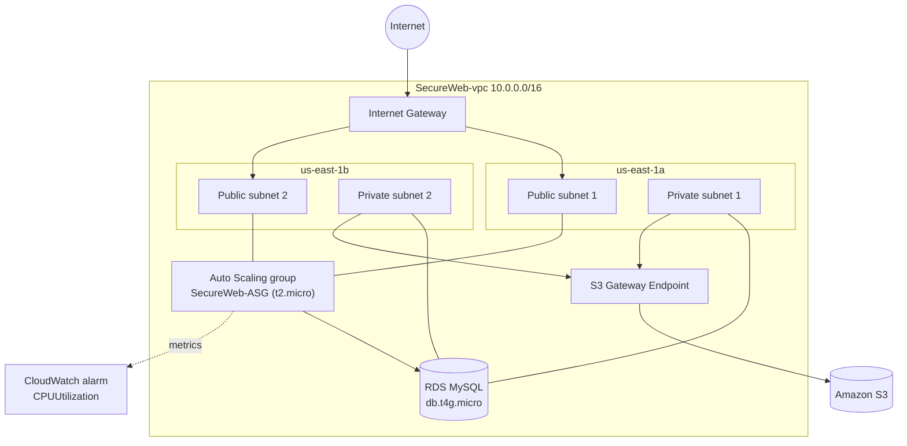

# AWS Cloud & Security Labs

Hands-on AWS work, from console builds in March–April 2025 to the **CIT 270 AWS Security Lab** (a two-tier app and a serverless counter, deployed with CloudFormation). It covers networking (VPC), compute (EC2, Auto Scaling, Lambda), identity (IAM, MFA), data (RDS, DynamoDB, S3, FSx) and security (security groups, NACLs, WAF, VPN, Backup).

Each lab says what I built and why. Shared concepts such as VPC routing, SG vs NACL and S3 security are explained once in [`docs/`](docs/), and the labs link to them.

All work was done in **us-east-1 (N. Virginia)**.

## Labs

| # | Lab | Main services | Focus |
|---|-----|---------------|-------|
| 1 | [Healthcare IAM & Multi-AZ RDS](labs/01-healthcare-iam-rds.md) | IAM, MFA, EC2, Security Groups, RDS (Multi-AZ cluster) | Least-privilege identities for a healthcare org |
| 2 | [SecureWeb: VPC, EC2, Auto Scaling & Monitoring](labs/02-secureweb-vpc.md) | VPC, Subnets, IGW, S3 Gateway Endpoint, EC2, SG, ASG, RDS, IAM Role, CloudWatch | Highly available two-AZ web stack |
| 3 | [Multi-Service Deployment](labs/03-multi-service-deployment.md) | EC2, Network Load Balancer, DynamoDB, S3, IAM Role, FSx for NetApp ONTAP | Using many AWS services together |
| 4 | [Secure Three-Tier Architecture ("EvilBank")](labs/04-secure-three-tier-architecture.md) | 3-AZ VPC + NAT, tiered SGs, IAM MFA, WAF, RDS, Route 53, AWS Backup, Site-to-Site VPN | Defense in depth for a banking scenario |
| 5 | [CIT 270: Two-Tier Security Lab](labs/05-two-tier-security-lab.md) | VPC, IGW, `sg-web`/`sg-app`, IAM role + instance profile, EC2, IMDSv2 | Firewall verification: build, break and restore SG rules |
| 6 | [CIT 270: Serverless Visitor Counter](labs/06-serverless-visitor-counter.md) | Lambda, DynamoDB, API Gateway, CloudWatch | Event-driven app with a least-privilege execution role |

Labs 1–4 are documented from console screenshots. Labs 5–6 come with deployable code and CloudFormation templates.

## Reference docs

| Document | Contents |
|----------|---------|
| [docs/vpc.md](docs/vpc.md) | CIDR, subnets, IGW, NAT, route tables, endpoints, peering, flow logs, how routing decisions are made |
| [docs/nacl-vs-sg.md](docs/nacl-vs-sg.md) | Stateful vs stateless firewalls, rule evaluation order, packet walkthrough |
| [docs/s3-security.md](docs/s3-security.md) | Bucket policies, Block Public Access, encryption, pre-signed URLs, common mistakes |
| [docs/security-analysis.md](docs/security-analysis.md) | Threat model, SG-to-SG referencing, IAM trust/permission scope, IMDSv2, defense in depth |
| [docs/aws-firewall-reference.md](docs/aws-firewall-reference.md) | All Lab 5 SG rules, IAM permissions, route tables and a full traffic matrix |
| [aws/security-groups/security-group-rules.md](aws/security-groups/security-group-rules.md) | Annotated `sg-web` / `sg-app` rules with verification steps |

## Architectures

### Lab 2: SecureWeb (console build)



### Lab 5: Two-tier web app (CloudFormation)

```
Internet
   │  HTTP/HTTPS (port 80/443)
   ▼
┌─────────────────────────┐       sg-web
│   Web Tier (EC2)        │  allows: 80, 443 from 0.0.0.0/0
│   nginx + static files  │  allows: 22 from YOUR_IP/32
│   Public subnet         │
└──────────┬──────────────┘
           │  port 3000 (sg-web → sg-app only)
           ▼
┌─────────────────────────┐       sg-app
│   App Tier (EC2)        │  allows: 3000 from sg-web ONLY
│   Node.js / Express     │  allows: 22 from YOUR_IP/32
│   Public subnet*        │  blocks: 3000 from internet
└─────────────────────────┘
* In production the app tier sits in a private subnet behind a NAT gateway.
```

The app tier's port 3000 source is `sg-web`, a security group reference instead of a CIDR. Any connection that doesn't come from an instance carrying `sg-web` is dropped at the hypervisor, and the OS never sees the packet. Lab 4 uses the same pattern for its Web Tier and App Tier security groups.

### Lab 6: Serverless visitor counter

```
Browser ──GET /visitors──▶ API Gateway (cit270-visitor-api, stage: prod)
                              │ Lambda proxy integration
                              ▼
                           Lambda cit270-visitor-counter (Python 3.12)
                              │ UpdateItem (atomic ADD), role scoped to UpdateItem + logs
                              ▼
                           DynamoDB cit270-visitor-counter (PAY_PER_REQUEST)
                              └──▶ CloudWatch Logs + Alarms (lambda-errors, apigw-4xx)
```

## What I learned

**Networking**
- How **VPC networking** (CIDR blocks, subnets, route tables, internet gateways, NAT gateways and VPC endpoints) controls what traffic can even reach an instance before the security group is checked. *(Labs 2, 4, 5 · [vpc.md](docs/vpc.md))*
- Why an **S3 gateway endpoint** is free and keeps S3 traffic off the internet. *(Labs 2, 4)*
- **Multi-AZ design** and its trade-offs: one NAT gateway versus one per AZ. *(Labs 2, 4)*
- **Site-to-Site VPN** with BGP for a private link from on-prem into the VPC. *(Lab 4)*

**Firewalls**
- **Security groups** are stateful firewalls on each instance, and referencing an SG as the source is more robust than a CIDR. *(Labs 1, 2, 4, 5 · [security-analysis.md](docs/security-analysis.md))*
- **Stateful (SG) vs stateless (NACL)** firewalls, and when to use each. *([nacl-vs-sg.md](docs/nacl-vs-sg.md))*
- **AWS WAF** web ACLs filter layer-7 attacks before they reach the app. *(Lab 4)*
- The **defense-in-depth** chain is IGW → NACL → Security Group → IAM, and each layer limits the damage on its own. *(Labs 4, 5)*

**Identity**
- **IAM roles and trust policies** give EC2 scoped permissions without hard-coded credentials, and an explicit `Deny` beats any `Allow`. *(Labs 2, 5 · [`aws/iam/`](aws/iam/))*
- **MFA**: authenticator apps versus FIDO2 passkeys. *(Labs 1, 4)*
- **IMDSv2** blocks SSRF attacks that try to steal instance credentials. *(Lab 5)*

**Compute, data and monitoring**
- **Auto Scaling groups** across AZs give self-healing capacity. *(Lab 2)*
- **RDS** comes as Multi-AZ clusters with readers or as single burstable instances, and **AWS Backup** adds 35-day retention. *(Labs 1, 2, 4)*
- **DynamoDB** suits key-value tables, and the `ADD` update expression increments atomically. *(Labs 3, 6)*
- **Lambda + API Gateway** together make a serverless HTTPS endpoint with CORS and stages. *(Lab 6)*
- **Load balancers**: NLB for layer 4, ALB for HTTP routing. *(Lab 3)*
- **S3 bucket policies and Block Public Access**, and why misconfigured buckets cause so many incidents. *([s3-security.md](docs/s3-security.md))*
- **CloudWatch alarms** on Auto Scaling CPU and on Lambda and API Gateway errors. *(Labs 2, 6)*
- **Infrastructure as Code** with CloudFormation (Labs 5–6) and Terraform (Lab 2 network).

## Repository structure

```
├── labs/                  Lab write-ups 01–06
├── docs/                  Shared reference docs (VPC, NACL vs SG, S3, security analysis, firewall reference)
├── images/                Console screenshots for labs 1–4
├── app/
│   ├── frontend/          Static web UI used to generate traffic for firewall testing (Lab 5)
│   ├── backend/           Node.js API that runs on the app-tier EC2 (Lab 5)
│   └── lambda/            Python Lambda for the visitor counter (Lab 6)
├── aws/
│   ├── cloudformation/
│   │   ├── lab-stack.yaml         VPC + SGs + IAM + EC2 (Lab 5)
│   │   └── serverless-stack.yaml  Lambda + DynamoDB + API Gateway + CloudWatch (Lab 6)
│   ├── iam/               Trust policy, EC2 role policy, student policy, Lambda execution policy
│   ├── scripts/           EC2 user-data bootstrap scripts
│   └── security-groups/   Annotated SG rule reference
└── terraform/
    └── secureweb-vpc/     Lab 2 network as Terraform
```

## Prerequisites (to deploy Labs 5–6 or the Terraform)

- AWS Academy / student account with EC2, Lambda, DynamoDB and API Gateway permissions
- AWS CLI configured (`aws configure`) or Management Console access
- A key pair in your target region
- Terraform ≥ 1.5 for `terraform/secureweb-vpc`

## Notes

- The screenshots come from a college lab environment. The resource IDs and IPs in them belong to that lab, not to production systems.
- These were learning environments, not production systems.
