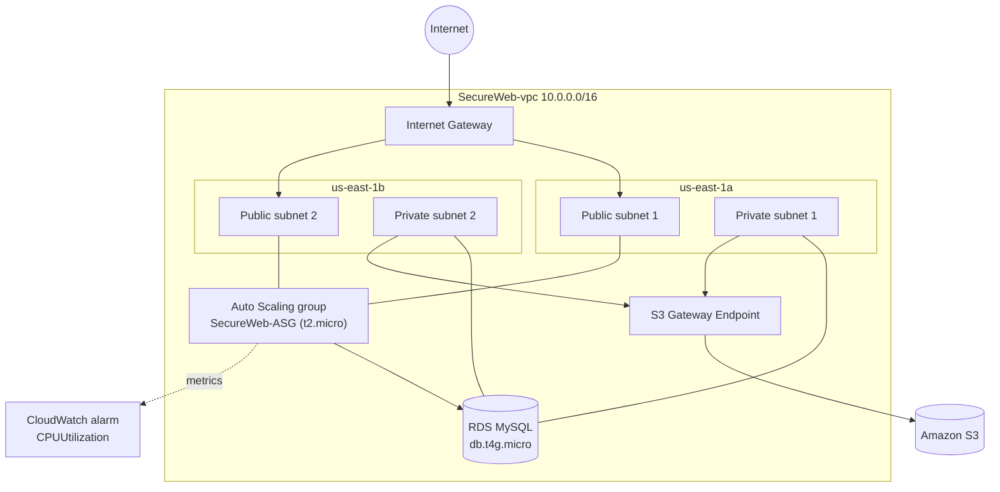

# AWS Cloud Labs

Hands-on AWS builds I did in March–April 2025, covering networking (VPC), compute (EC2, Auto Scaling), identity (IAM, MFA), data (RDS, DynamoDB, S3, FSx) and security (security groups, WAF, VPN, Backup). Each lab says what I built, why each piece is there, and what I learned.

All work was done in **us-east-1 (N. Virginia)**.

## Labs

| # | Lab | Main services | Focus |
|---|-----|---------------|-------|
| 1 | [Healthcare IAM & Multi-AZ RDS](labs/01-healthcare-iam-rds.md) | IAM, MFA, EC2, Security Groups, RDS (Multi-AZ cluster) | Least-privilege identities for a healthcare org |
| 2 | [SecureWeb: VPC, EC2, Auto Scaling & Monitoring](labs/02-secureweb-vpc.md) | VPC, Subnets, IGW, S3 Gateway Endpoint, EC2, SG, Launch Template, ASG, RDS, IAM Role, CloudWatch | Highly available two-AZ web stack |
| 3 | [Multi-Service Deployment](labs/03-multi-service-deployment.md) | EC2, Network Load Balancer, DynamoDB, S3, IAM Role, FSx for NetApp ONTAP | Using many AWS services together |
| 4 | [Secure Three-Tier Architecture ("EvilBank")](labs/04-secure-three-tier-architecture.md) | 3-AZ VPC + NAT, tiered SGs, IAM MFA, WAF, RDS, Route 53, AWS Backup, Site-to-Site VPN | Defense in depth for a banking scenario |

There's also [Terraform for the SecureWeb VPC](terraform/secureweb-vpc/), which rebuilds the Lab 2 network as code.

## Big-picture architecture (Lab 2 – SecureWeb)

## Skills shown

- Designing a **multi-AZ VPC** with public and private subnets, route tables, an internet gateway, a NAT gateway and VPC endpoints
- Writing **least-privilege security groups**: SSH limited to my own IP, and tiers that reference each other's security groups
- **IAM**: users, roles with trust policies, instance profiles, MFA
- **High availability**: Auto Scaling groups across AZs, Multi-AZ RDS with reader replicas, load balancers
- **Security services**: AWS WAF web ACLs, AWS Backup plans, Site-to-Site VPN
- **Monitoring**: CloudWatch alarms on Auto Scaling metrics
- **Infrastructure as Code**: Terraform rebuild of the VPC

## Notes

- The screenshots come from a college lab account. The resource IDs and IPs in them belong to lab resources that no longer exist.
- These were learning environments, not production systems.
