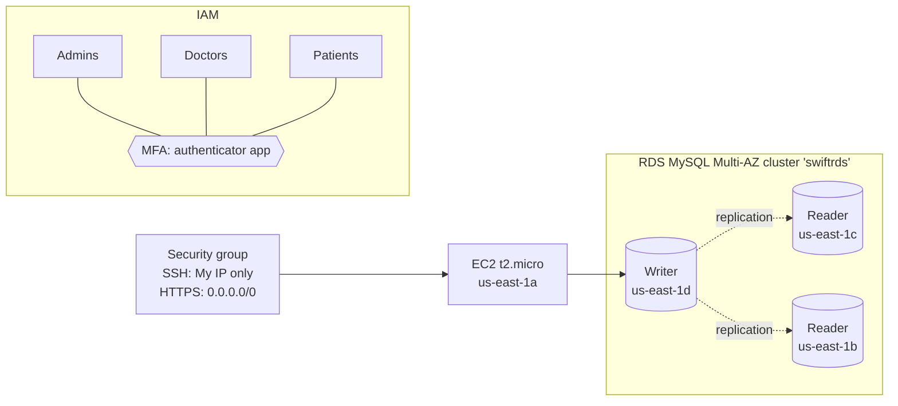

# Lab 1: Healthcare IAM & Multi-AZ RDS

**Date:** March 2025
**Scenario:** A healthcare provider needs separate access for administrators, doctors and patients, a secure way into its servers, and a database that stays up if a data center fails.

## What I built

### 1. IAM users for each role
- Created three IAM users that map to the organization's roles: **Admins**, **Doctors**, **Patients**.
- Checked the account's default service-linked roles (CloudWatch Events, Support, Trusted Advisor) to see what AWS creates automatically.

### 2. MFA
- Turned on multi-factor authentication with an **authenticator app** (TOTP). A stolen password alone isn't enough to sign in, which is a baseline requirement for anything that touches patient data (HIPAA).

### 3. Security group for the server
| Type | Port | Source | Why |
|------|------|--------|-----|
| SSH | 22 | My IP (/32) | Only I can manage the box |
| HTTPS | 443 | 0.0.0.0/0 | Public, encrypted web access |

AWS warns about `0.0.0.0/0`. That's acceptable for HTTPS on a public site, but never for SSH.

### 4. EC2 instance
- Launched a **t2.micro** in **us-east-1a** with the security group above.

### 5. Multi-AZ RDS cluster
- Created **`swiftrds`**, a **MySQL Multi-AZ DB cluster** with one **writer** and **two readers** across three AZs (1b, 1c, 1d) on `db.m5d.large`.
- If the writer's AZ fails, a reader is promoted automatically. The readers can also take read-heavy queries such as record lookups.

## What I learned
- Splitting identities by role is the first step toward least privilege. The next step would be IAM **groups** with scoped policies, so permissions aren't attached to individual users.
- Restricting SSH to a single `/32` closes the most common attack path on a new EC2 instance.
- A Multi-AZ **cluster** (one writer, two readers) gives faster failover and read scaling than a classic Multi-AZ **instance**, which has only a passive standby.
