# Lab 2: SecureWeb (VPC, EC2, Auto Scaling & Monitoring)

**Date:** March 2025
**Goal:** Build a secure, highly available web environment from scratch: a custom network, web servers that heal themselves, a managed database, least-privilege access and monitoring.

## Architecture

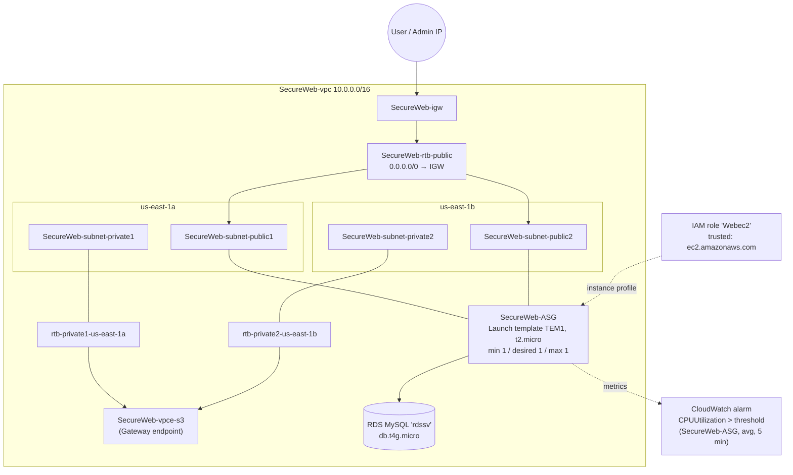

## Step by step

### 1. Create the VPC ("VPC and more" wizard)
| Setting | Value |
|--------|-------|
| Name tag | `SecureWeb` (auto-generated names) |
| IPv4 CIDR | `10.0.0.0/16` (65,536 addresses) |
| IPv6 | None |
| Tenancy | Default |
| AZs | 2 (`us-east-1a`, `us-east-1b`) |
| Public subnets | 2 |
| Private subnets | 2 |
| VPC endpoint | S3 Gateway |

The workflow created and connected all of this:
- VPC with **DNS hostnames** and **DNS resolution** turned on
- 4 subnets
- Internet gateway, attached to the VPC
- 1 public route table (default route to the IGW) plus 1 private route table per AZ
- **S3 gateway endpoint** associated with the private route tables, so private subnets reach S3 without going over the internet and with no NAT data charges

### 2. Launch an EC2 instance
- A **t2.micro** in `us-east-1a`, given a public IPv4 address by the public subnet.

### 3. Lock down the security group
| Type | Port | Source |
|------|------|--------|
| All traffic | All | The security group itself (instances in the group can talk to each other) |
| HTTP | 80 | My IP /32 |
| HTTPS | 443 | My IP /32 |
| SSH | 22 | My IP /32 |

While testing, only my own IP can reach the site and SSH.

### 4. Auto Scaling group
- Made a **launch template (`TEM1`)** for `t2.micro`.
- Created **`SecureWeb-ASG`** in `SecureWeb-vpc` across **us-east-1a and us-east-1b**, with the *Balanced best effort* AZ distribution.
- Capacity: **min 1 / desired 1 / max 1**. This is a self-healing setup: if the instance fails a health check, the ASG replaces it, in whichever AZ is healthy.

### 5. RDS database
- Created **`rdssv`**, a **MySQL Community** instance on **db.t4g.micro** (Graviton, free-tier eligible).

### 6. IAM role for EC2
- Created role **`Webec2`** with this trust policy, so EC2 can assume it:

```json
{
  "Version": "2012-10-17",
  "Statement": [
    {
      "Effect": "Allow",
      "Action": ["sts:AssumeRole"],
      "Principal": { "Service": ["ec2.amazonaws.com"] }
    }
  ]
}
```

- Attached it to the instance with **Modify IAM role**. The app gets temporary credentials from the instance metadata service, so no access keys are stored on the server.

### 7. CloudWatch alarm
- Metric: `AWS/EC2 › CPUUtilization`, dimension **AutoScalingGroupName = SecureWeb-ASG**
- Statistic: **Average**, period **5 minutes**, static threshold, **Greater than**
- Can be wired to an SNS notification or a scaling policy.

## What I learned
- The "VPC and more" wizard is a quick way to see how subnets, route tables, the IGW and endpoints depend on each other. The [Terraform version](../terraform/secureweb-vpc/) shows the same wiring written out in code.
- A **gateway endpoint for S3** is free and keeps S3 traffic on the AWS network, so private subnets don't need a NAT gateway just to reach S3.
- **IAM roles beat access keys** on EC2: the credentials rotate automatically and there's nothing on disk to leak.
- An ASG with min = max = 1 still adds value as **automatic recovery**, even when you aren't scaling out.

## Screenshots

**VPC wizard preview: subnets, route tables, IGW and S3 endpoint**
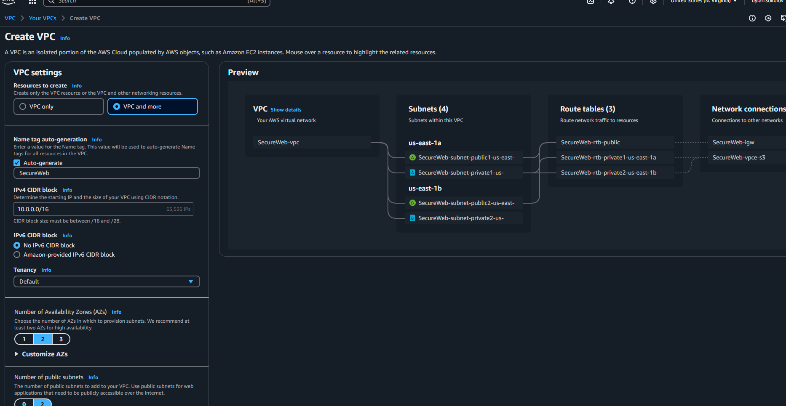

**Every resource the VPC workflow created**
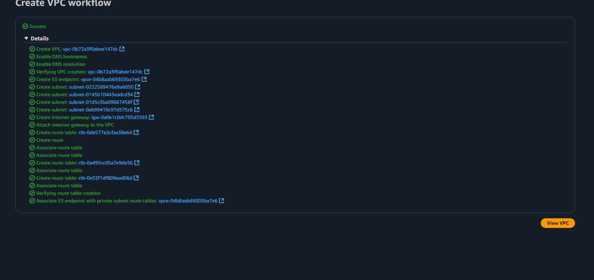

| | |
|---|---|
| **EC2 instance launching**<br>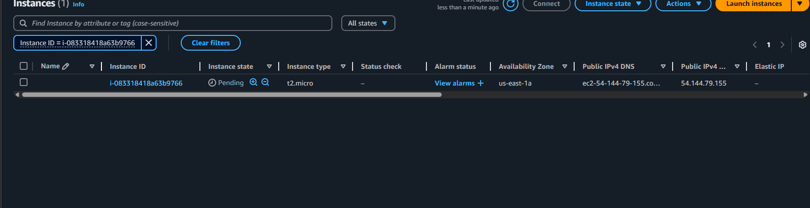 | **Security group inbound rules**<br>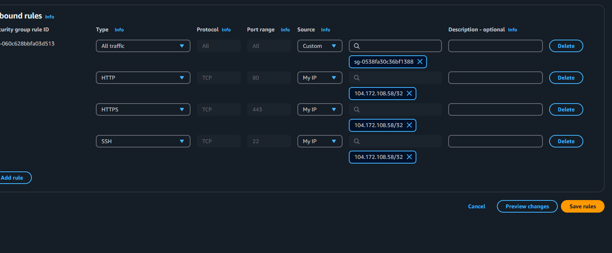 |
| **ASG launch options in SecureWeb-vpc**<br>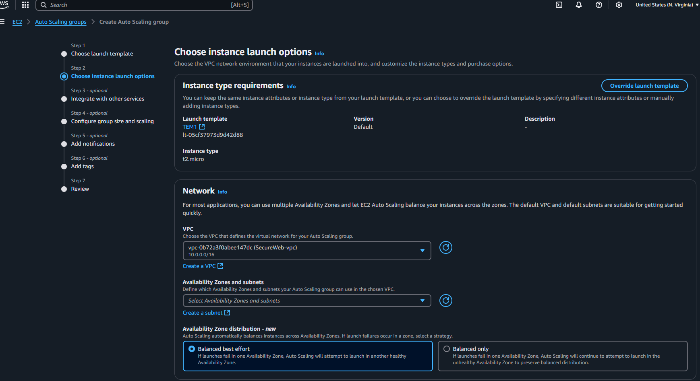 | **SecureWeb-ASG across 2 AZs**<br>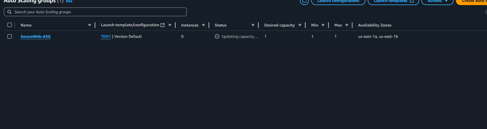 |
| **RDS MySQL instance creating**<br>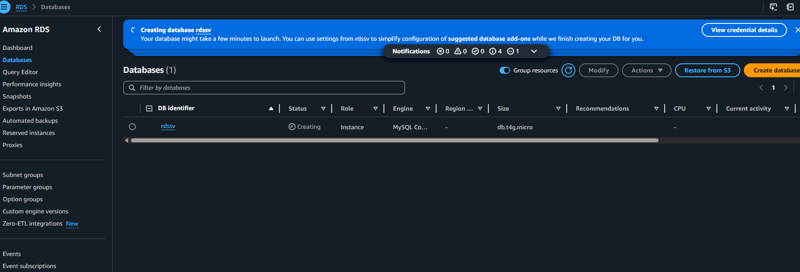 | **IAM role `Webec2` trust policy**<br>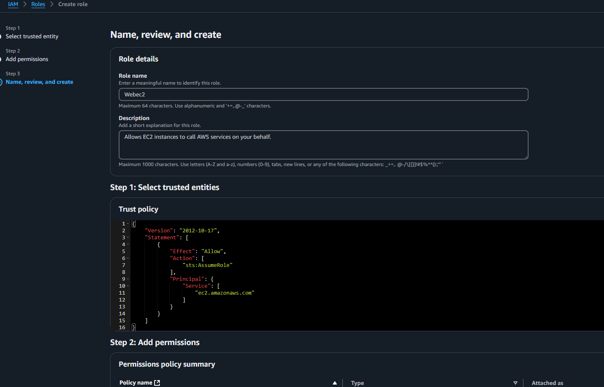 |
| **Attaching the role to the instance**<br>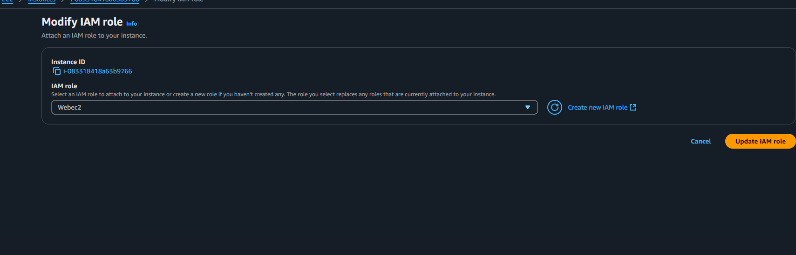 | **CloudWatch CPU alarm on the ASG**<br>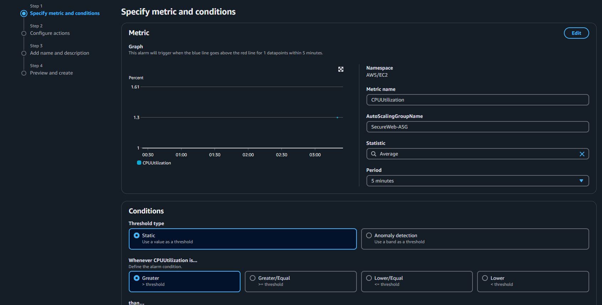 |
