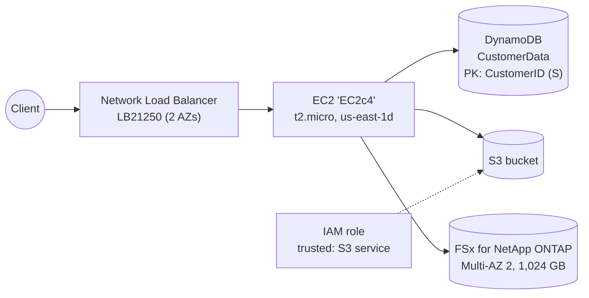

# Lab 3: Multi-Service Deployment

**Date:** March 2025
**Goal:** Deploy and connect several core AWS services (compute, load balancing, NoSQL, object storage, IAM and managed file storage) in one environment.

## What I built

### 1. EC2
- Launched **`EC2c4`** (t2.micro) in `us-east-1d` and waited for it to show **Running**.

### 2. Network Load Balancer
- Created **`LB21250`**, type **network** (layer 4, TCP/UDP), across **2 Availability Zones**.
- An NLB keeps the client's source IP and handles very high connection rates with low latency. The trade-off compared with an ALB is that it can't route on HTTP paths.

### 3. DynamoDB
- Created table **`CustomerData`** with partition key **`CustomerID` (String)** and on-demand capacity.
- Serverless and pay-per-request, a good fit for key-value lookups by customer.

### 4. S3
- Created a general purpose bucket in `us-east-1`.

### 5. IAM role for S3
- Started a role with **AWS service → S3** as the trusted entity, so S3 itself can act on other resources (for example for replication or batch operations).

### 6. FSx for NetApp ONTAP
Reviewed and created a managed file system:

| Attribute | Value |
|-----------|-------|
| Type | Amazon FSx for NetApp ONTAP |
| Deployment | **Multi-AZ 2** |
| HA pairs | 1 (1 active, 1 passive file server) |
| Storage capacity | 1,024 GB |
| SSD IOPS | Automatic (3,072) |
| Throughput | 384 MB/s |

## What I learned
- Which **load balancer** to use: NLB for raw TCP performance and static IPs, ALB for HTTP routing.
- When to use **DynamoDB vs RDS**: DynamoDB for simple, high-scale key lookups, RDS for relational queries and joins.
- **FSx for ONTAP** brings enterprise NAS features (NFS/SMB, snapshots, replication) to AWS, and Multi-AZ gives it automatic failover.
- Checking which settings are **editable after creation** (deployment type and HA pairs aren't) before clicking Create.
