# Lab 4: Secure Three-Tier Architecture ("EvilBank")

**Date:** April 2025
**Scenario:** A fictional bank ("EvilBank") needs a production-style AWS environment with **defense in depth**: network isolation, tiered firewalls, strong identity, a web application firewall, backups, DNS and a private link back to the office.

## Architecture

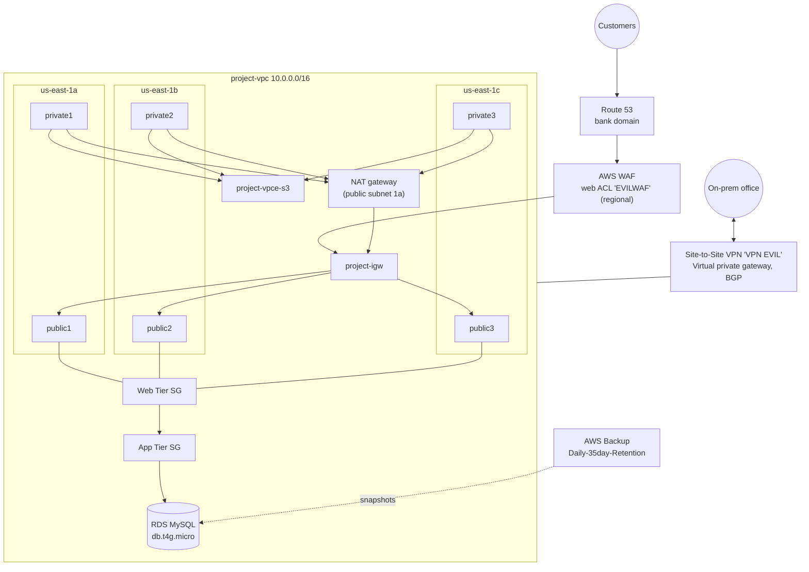

## Step by step

### 1. VPC across three AZs
| Setting | Value |
|--------|-------|
| Name | `project` |
| CIDR | `10.0.0.0/16` |
| AZs | **3** (us-east-1a, 1b, 1c) |
| Subnets | 3 public + 3 private |
| Route tables | 1 public + 3 private |
| NAT gateway | 1 (in public subnet 1a) |
| Endpoint | S3 gateway |

The **NAT gateway** lets private instances reach the internet for patches without being reachable from it.

### 2. Tiered security groups
**Web Tier**: built for the internet-facing layer.

| Direction | Type | Port | Destination |
|-----------|------|------|-------------|
| Outbound | All traffic | All | 0.0.0.0/0 |
| Outbound | HTTP | 80 | 0.0.0.0/0 |
| Outbound | HTTPS | 443 | 0.0.0.0/0 |

**App Tier**: only talks to the tier it's chained to.

| Direction | Type | Port | Destination |
|-----------|------|------|-------------|
| Outbound | All traffic | All | 0.0.0.0/0 |
| Outbound | Custom TCP | — | **Another security group (by SG ID)** |

Referencing a **security group ID** instead of a CIDR means the rule follows the instances as they scale, with no IP lists to keep updated.

### 3. IAM & MFA
- Reviewed the service-linked roles AWS created for **Elastic Load Balancing** and **RDS**.
- Registered an MFA device with the **passkey/security key** option (FIDO2), the most phishing-resistant choice.

### 4. AWS WAF
- Created a regional web ACL **`EVILWAF`** in us-east-1, with CloudWatch metrics under the same name, to attach to the load balancer and filter SQL injection, XSS and bad bots before they reach the app.

### 5. RDS
- Created a MySQL instance on **db.t4g.micro** (burstable class) with a self-managed admin password. Next time I'd let **AWS Secrets Manager** manage and rotate it.

### 6. Route 53
- Looked up domain availability for the bank's domain in **Route 53 → Register domains** to give the app a public DNS name.

### 7. AWS Backup
- Backup plan **`EVIL DBUA`** from the **Daily-35day-Retention** template, with rule `DailyBackups` going to the default vault.

### 8. Site-to-Site VPN
| Setting | Value |
|---------|-------|
| Name | `VPN EVIL` |
| Target gateway | Virtual private gateway |
| Customer gateway | Existing |
| Routing | **Dynamic (BGP)** |
| Local IPv4 CIDR | `10.0.0.0/16` |
| Remote IPv4 CIDR | `0.0.0.0/0` |

This gives the office an encrypted IPsec tunnel into the VPC, so admin traffic never goes over the public internet.

## Security layers at a glance

| Layer | Control |
|-------|---------|
| Edge | Route 53, AWS WAF |
| Network | Public/private subnets, NAT, S3 endpoint, VPN |
| Instance | Web/App tier security groups chained by SG ID |
| Identity | IAM, FIDO2 MFA |
| Data | RDS in private subnets, AWS Backup with 35-day retention |

## What I learned
- How **defense in depth** looks on AWS: each layer assumes the one in front of it might fail.
- Chaining security groups is cleaner and safer than hard-coding IP ranges.
- Spreading across **three AZs** with a single NAT gateway is a cost trade-off. In production, use one NAT per AZ so losing an AZ doesn't cut off outbound traffic.
- Backups are only useful if you **test the restores**, which is the next step for this lab.

## Screenshots

**3-AZ VPC with NAT gateway and S3 endpoint**
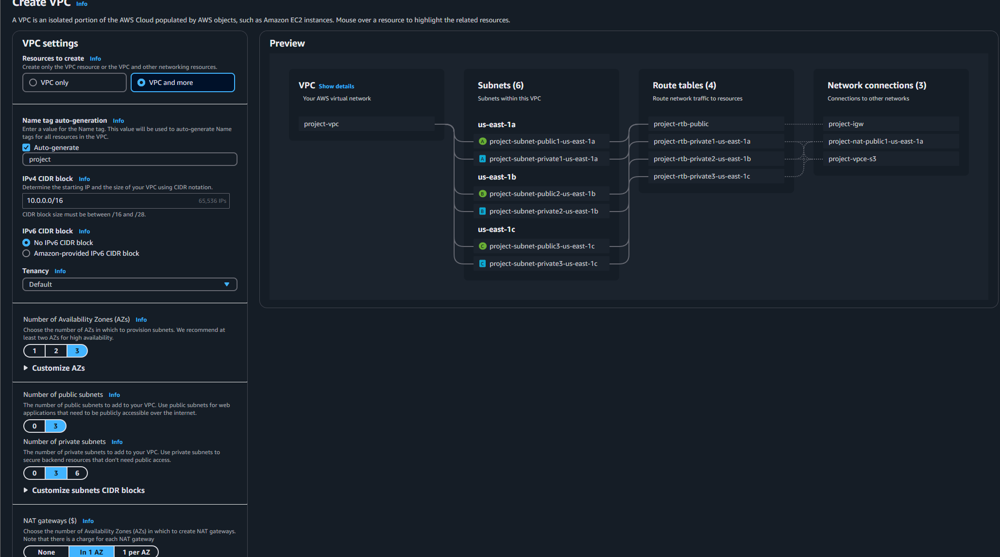

| | |
|---|---|
| **Web Tier security group** 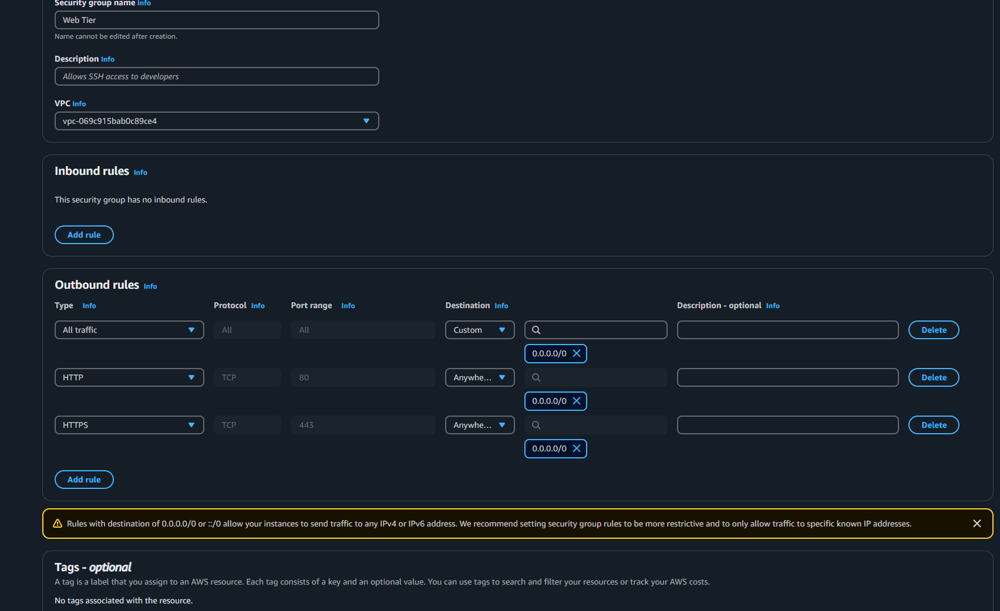 | **App Tier security group (references another SG)** 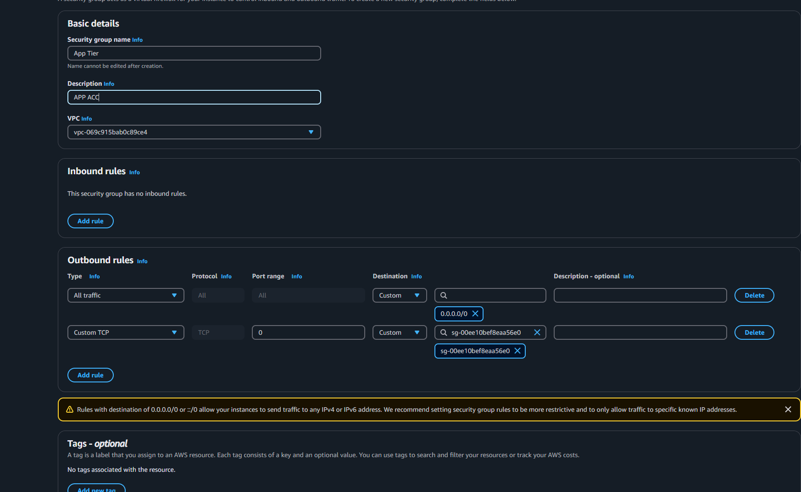 |
| **Service-linked roles for ELB and RDS** 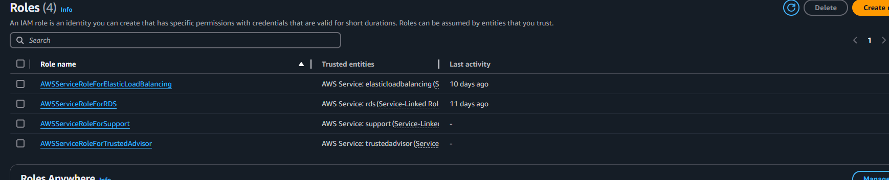 | **MFA with a passkey/security key** 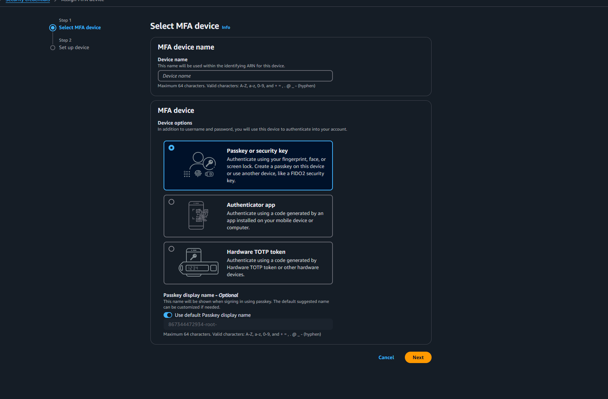 |
| **WAF web ACL `EVILWAF`** 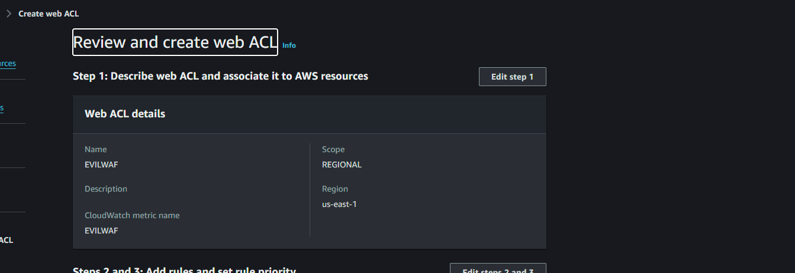 | **RDS MySQL settings** 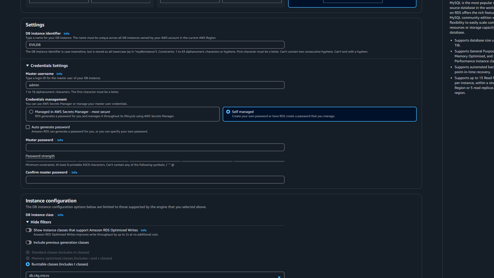 |
| **Route 53 domain search** 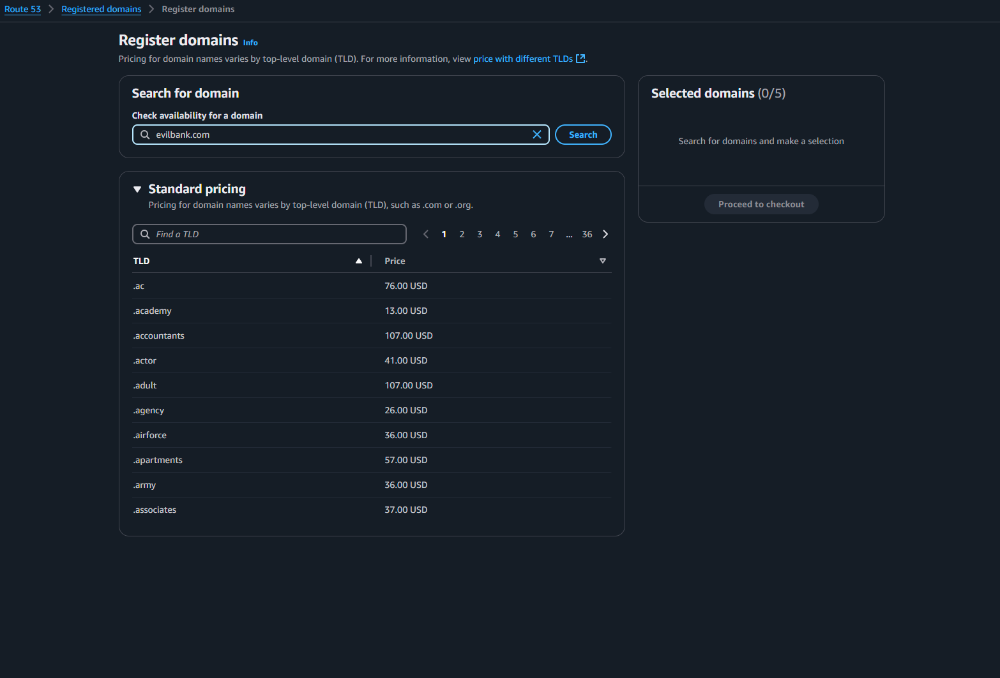 | **AWS Backup plan (35-day retention)** 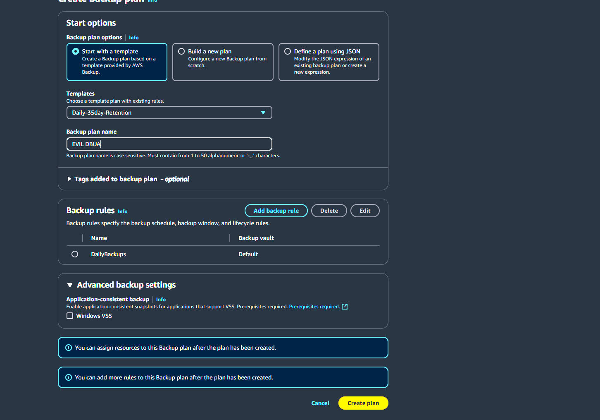 |
| **Site-to-Site VPN (BGP)** 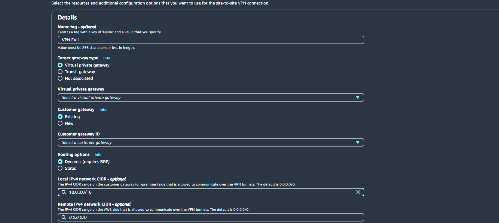 | |
